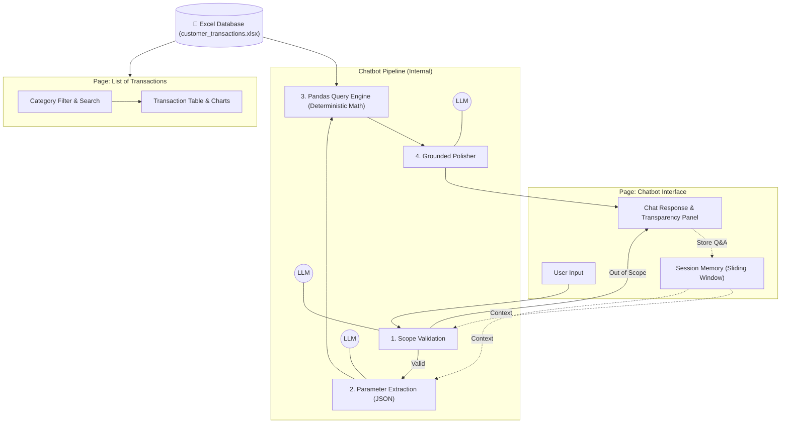

# Financial Chatbot Prorotype for Customer Banking App

## ABOUT

This project is the proof-of-concept for an AI-assistant inside a user's banking app. The core priority is a **transparent**, **safe**, and **easy** **chatting experience**, with the chatbot providing evidence to its answers and being able to see remember conversation context.

> Test it right away at the [DEPLOYED APP](https://bot-for-bills.streamlit.app)!

The application implements natural-language-to-SQL translation using Gemini Flash 3.5 Lite, with queries executed deterministically for high accuracy and no hallucination. Memory for chat is also integrated here.


## PROTOTYPE

The prototype gets organized into a two-page Streamlit application.
| Page | Description |
| :--- | :--- |
| **List of Transactions** | Displays customer's transaction data with category filtering. |
| **Finance Chatbot** | Conversational assistant answering questions with evidence attachment. |

<br>


For this prototype, a single verified customer account is used:
- **CIF ID:** `100550`
- **Customer Name:** Shane Parker
- **Account Type:** Basic
- **Region:** Jakarta
- **Data Source:** `resources/customer_transactions.xlsx` (with 70 transactions distributed from January 2025 to present)

## ARCHITECTURE




1. **Pre-filter & Data Process (`prefilter.py` & `transactions_page.py`)**:
   - Reads user transactions directly from Excel.
   - Categorizes spending into structured banking categories.
   - Provides an interactive category filter on the transaction list page.

2. **Chatbot Translation Pipeline & Memory (`process.py` & `chatbot_page.py`)**:
   - **Session Memory (Sliding Window + Summary Buffer)**: Retains preceding question-and-answer pairs within the session. If turns exceed window size, older turns are compacted into a concise summary buffer. 
   - **Validation**: To limit prompt injection possibilities, queries will be categorized into any of the below regulated operation types only:
      - `sum`: Total spending calculations (e.g., *"What is my total spending on groceries?"*)
      - `list`: Listing transaction records (e.g., *"List my payments to Starbucks"*)
      - `count`: Counting transactions (e.g., *"How many times did I pay for fuel?"*)
      - `max` / `min`: Finding highest or lowest payments (e.g., *"What was my most expensive purchase?"*)
   - **Parameter Extraction**: LLM resolves coreferences and translates natural language into structured JSON.
   - **Deterministic Execution**: Dataframe computation calculates exact spending and retrieves grounded records.
   - **Polisher**: LLM formats the final response based strictly on the retrieved records and conversational context.

## SETUP

To run locally, clone this repository and follow the next steps.

1. Install dependencies:
   ```bash
   pip install -r requirements.txt
   ```

2. Create `.env` and add your Gemini API key inside:
   ```env
   GEMINI_API_KEY=your_gemini_api_key_here
   ```

3. Run the Streamlit app:
   ```bash
   streamlit run app.py
   ```

## Author

All contributions are made by the repository owner only.
